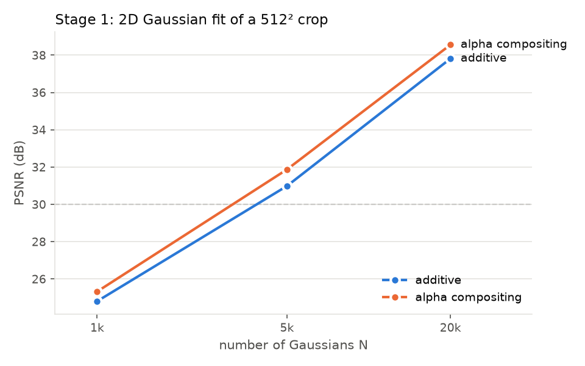
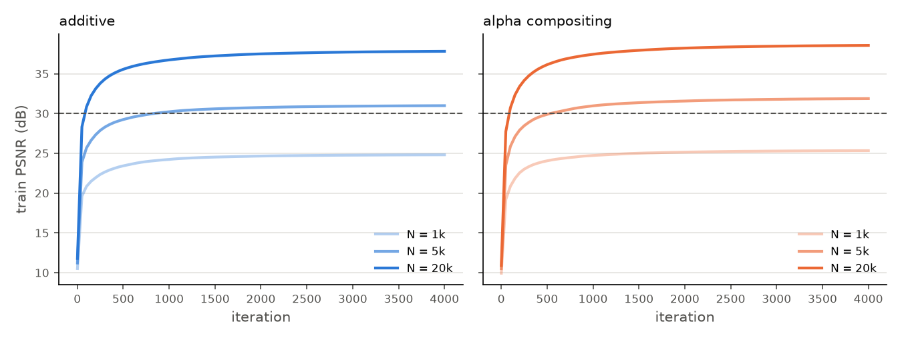
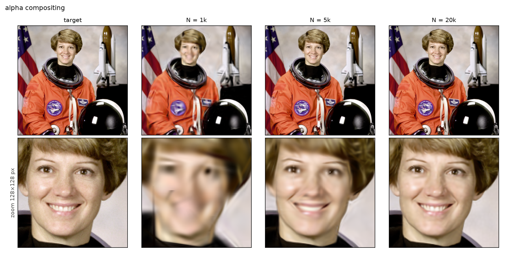
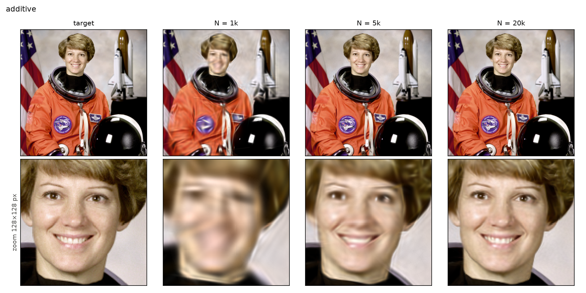

# Gaussian Splatting of a potted plant, from scratch on a T4

A progressive, mostly from-scratch implementation of 3D Gaussian Splatting
(Kerbl et al., SIGGRAPH 2023), ending with the highest-fidelity reconstruction a single
NVIDIA T4 can produce of a golden pothos in a terracotta pot. Each stage is built, tested
and explained before the next; this README is updated with the results of every stage.

| Stage | Topic | Status |
|---|---|---|
| 0 | Environment and scaffolding | ✅ |
| 1 | 2D Gaussian image fitting | ✅ 38.56 dB @ 20k Gaussians (placeholder image) |
| 2 | 3D forward model in pure PyTorch | in progress |
| 3 | Synthetic inverse problem | |
| 4 | Blender lego with my renderer | |
| 5 | Tiled CUDA rasterizer (gsplat) | |
| 6 | Plant data pipeline | |
| 7 | Plant training ablations | |
| 8 | Pushing the T4 to maximum detail | |
| 9 | Evaluation and deliverables | |

## Quick start

```bash
bash scripts/setup_env.sh            # Miniforge + conda env "gsplat" on /mnt (once)
conda activate gsplat
pytest                               # renderer unit tests + gradcheck
python -m src.fit2d model.n=20000    # Stage 1: fit an image with 2D Gaussians
bash scripts/tensorboard.sh          # TensorBoard on :6006 (ssh -L 6006:localhost:6006 <vm>)
```

Every run writes `outputs/<date>_<name>/` with the merged `config.yaml`, `meta.json`
(git commit, torch/CUDA, GPU), `metrics.json`, TensorBoard logs and renders.
Configs are YAML in `configs/`, inherit with `_base_:`, and accept `key=value` overrides.

---

## Stage 0: Environment

| | |
|---|---|
| GPU | Tesla T4, 15 GB, sm_75, driver 580.178.04 |
| CPU / RAM | 15 cores Xeon Gold 5218, 88 GiB |
| Disk | 24 GB root (nearly full) + 500 GB ephemeral volume reformatted to ext4 at `/mnt` |
| Software | Python 3.12, torch 2.14.1+cu126, nvcc 12.6 + gcc 13, gsplat 1.5.3 (JIT, sm_75), COLMAP 3.12.6 (CPU) |

**What the T4 can actually deliver** (`scripts/gpu_bench.py`, 15 s sustained per test):

| Workload | Measured | Spec | SM clock under load |
|---|---|---|---|
| FP32 matmul | 4.32 TFLOPS | 8.1 | 870 MHz (power-capped) |
| FP16 tensor-core matmul | 25.2 TFLOPS | 65 | 690–735 MHz (power-capped) |
| Device memory copy | 232 GB/s | 320 | 1590 MHz (full boost) |

The card is pinned at its **70 W limit** (which is also the maximum allowed), and thermals
are fine (< 50 °C). Dense arithmetic drops the clock to about half of boost, while
memory-bound kernels run at full speed. Splatting is bandwidth- and launch-bound, so the
way to "use the whole T4" is to keep it busy (GPU-resident data, no per-iteration host
syncs, fused kernels), not to chase FLOPS.

Setup pitfalls hit and fixed: Ubuntu's `colmap` package is missing its `libposelib`
dependency; conda's `cuda-nvcc` activation script breaks under `set -u`; conda-forge keeps
CUDA headers in `targets/x86_64-linux/include`, so gsplat's JIT build needs `CPATH`.

---

## Stage 1: Fitting an image with 2D Gaussians

Fit a 512×512 crop with N 2D Gaussians, each with a mean μ, rotation θ, log-scales,
an RGB color and a sigmoid opacity. Code: [`src/splat2d.py`](src/splat2d.py) (renderer),
[`src/fit2d.py`](src/fit2d.py) (training), tests in
[`tests/test_splat2d.py`](tests/test_splat2d.py).

> The target is a **placeholder** (the 512×512 `astronaut` test image) until the plant
> photos are captured; `bash scripts/stage1_sweep.sh image.path=<plant crop>` reruns
> everything.

### Model

In pixel coordinates (x right, y down, pixel centers at half-integers):

$$
\Sigma = R(\theta)\,\mathrm{diag}(s_1^2, s_2^2)\,R(\theta)^\top,\qquad
q(p) = (p-\mu)^\top \Sigma^{-1} (p-\mu) = \left(\tfrac{u}{s_1}\right)^2 + \left(\tfrac{v}{s_2}\right)^2,\quad
\begin{pmatrix}u\\v\end{pmatrix} = R^\top (p-\mu)
$$

$G(p) = e^{-q/2}$, truncated to the 3σ ellipse $q < 9$. Working in the Gaussian's own
frame means Σ is never inverted.

- **Additive:** $C(p) = \sum_k o_k G_k(p)\, c_k$
- **Alpha compositing** (front to back in a fixed depth order):
  $\alpha_k = \min(0.99,\ o_k G_k)$, $\;C = \sum_k c_k \alpha_k T_k + T_\text{final}\,\text{bg}$,
  $\;T_k = \prod_{j<k}(1-\alpha_j)$, with 3DGS early termination
  (stop once $T_k(1-\alpha_k) < 10^{-4}$).

**Sparse evaluation.** A dense N × HW tensor would hold 5·10⁹ entries at N = 20k. Instead
the renderer enumerates only (Gaussian, pixel) pairs inside each 3σ ellipse (2–4 M pairs),
sorts them by (pixel, depth), and computes the transmittance as a per-pixel running sum
in log space:

$$\log T_k = \sum_{j<k,\ \text{same pixel}} \log(1-\alpha_j)$$

That is one global `cumsum` minus its value at each pixel's first pair. It must be done in
**float64**: the global sum reaches about −10⁶, and float32 would lose about 0.1 in log T to
cancellation.

**Verification:** the sparse renderer matches a brute-force dense renderer to 1e-10 (both
blending modes, with and without early termination), and `torch.autograd.gradcheck`
passes in float64 for means, rotation, scales, colors and opacity.

### Results (4000 Adam iterations, L2 loss, uniform random init)

| Blending | N | PSNR (dB) | ms / iter | pairs (M) | peak VRAM (GB) |
|---|---|---|---|---|---|
| additive | 1k | 24.81 | 52 | 2.02 | 0.77 |
| additive | 5k | 30.99 | 58 | 2.27 | 0.96 |
| additive | 20k | 37.82 | 61 | 2.33 | 1.03 |
| alpha | 1k | 25.33 | 84 | 2.58 | 1.06 |
| alpha | 5k | 31.87 | 117 | 3.57 | 1.69 |
| alpha | 20k | **38.56** | 129 | 3.97 | 1.95 |

Acceptance (> 30 dB at 20k Gaussians on a 512 px crop): ✅ 38.56 dB.





Alpha compositing renders: full image (top) and a 128×128 zoom on the face (bottom):



Additive renders, for comparison:



### Observations

1. **Additive is within 0.5–0.9 dB of alpha compositing and about 2× faster.** In 2D nothing
   occludes anything, so depth ordering adds little flexibility. It becomes essential in
   3D, where occlusion has to be modelled.
2. **PSNR is linear in log N**: about +6.6 dB per 4× Gaussians, i.e. MSE ∝ N^−1.1.
   At 1k the face is a blur, 5k recovers shapes but not freckles or hair strands, and 20k
   is close to the target.
3. **Alpha blending pays for hidden Gaussians.** Pair counts grow from 2.6 M to 4.0 M with
   N because Gaussians grow as they get stacked. In this pair-based layout early
   termination only zeroes their contribution; it doesn't skip the work. This overdraw is
   what a tiled CUDA rasterizer (Stage 5) avoids.
4. **The first bottleneck was autograd, not the math.** 45 % of GPU time was the
   sort-based backward of `x[gid]` gathers. Sorting the integer pairs before any
   differentiable step and using a single packed `index_select` gave 1.35×. The cost is
   that the backward pass is now non-deterministic at the ~10⁻¹⁶ level.

---

## Repository layout

```
configs/      one YAML per experiment
data/      -> /mnt/data      (raw photos, masks, COLMAP, nerf_synthetic; not in git)
outputs/   -> /mnt/outputs   (runs; not in git)
docs/figures/                figures embedded in this README
scripts/      setup_env.sh, check_env.py, gpu_bench.py, gsplat_smoke.py, tensorboard.sh,
              stage1_sweep.sh, plot_stage1.py
src/          config.py, run.py, splat2d.py, fit2d.py, and stubs for the 3D pipeline
tests/        pytest suite
```
