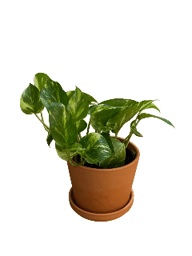
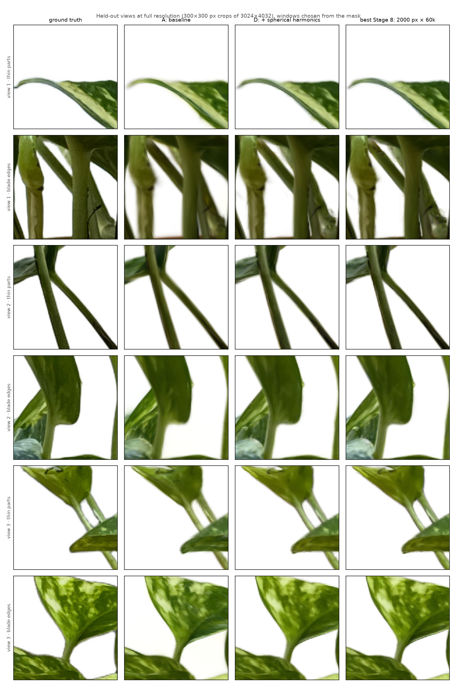

# Gaussian Splatting from scratch on a single T4

**3D Gaussian Splatting** (Kerbl et al., SIGGRAPH 2023) built step by step, mostly from
scratch, then used to reconstruct a real object, a golden pothos in a terracotta pot,
from 216 phone photos on one NVIDIA T4 (16 GB).

<p align="center"><br>
<em>Fly-through along the interpolated capture path, rendered from the final model
(454k Gaussians, view-dependent color). <a href="docs/figures/pothos_flythrough.mp4">MP4 (960×1280)</a></em></p>

## Results

| stage | what | result |
|---|---|---|
| 1 | fit a photo with 2D Gaussians, my renderer | 38.6 dB with 20k Gaussians (512²) |
| 2 | 3D renderer in pure PyTorch | 15 tests incl. `gradcheck`; EWA = autograd Jacobian to 10⁻¹⁰ |
| 3 | recover 200 known Gaussians | 81 % from random init, 97.5 % with 2× Gaussians |
| 4 | NeRF-Synthetic lego, my renderer | 27.9 dB at 400²; limit ~80 M pixel–Gaussian pairs |
| 5 | gsplat CUDA rasterizer + my densification | **lego 34.15 dB at 800²** in 15 min |
| 6 | plant: poses, masks, loader (all GPU) | 216/216 photos posed in 10 min, 1.0 px error |
| 7 | plant ablation (5 runs) | spherical harmonics is the largest single gain |
| 8 | densification × resolution × schedule (9 runs) | **LPIPS 0.0628**: 2000 px × 60k it., 4.8 GB, 2 h |
| 9 | deliverables | final table, crops, `.ply` (SuperSplat), fly-through video |

**Final ablation on the plant.** 27 held-out photos, scored at full resolution
(3024×4032); "plant only" = PSNR inside the foreground mask.

| run | PSNR | plant only | SSIM | LPIPS ↓ | Gaussians |
|---|---|---|---|---|---|
| A: baseline (SfM init, RGB color) | 30.18 | 24.23 | 0.962 | 0.0738 | 74k |
| B: + mask loss | 30.17 | 24.22 | 0.962 | 0.0739 | 74k |
| C: + adaptive density control | 30.44 | 24.54 | 0.964 | 0.0692 | 368k |
| D: + spherical harmonics (degree 3) | 31.44 | 25.48 | 0.968 | 0.0659 | 390k |
| E: D with random initialization | 31.42 | 25.44 | 0.967 | 0.0683 | 327k |
| **best: D trained at 2000 px for 60k iterations** | **31.74** | **25.90** | **0.969** | **0.0628** | 454k |

Every number comes from a logged run (config, git commit, metrics); the full record is
**[docs/DETAILED_NOTES.md](docs/DETAILED_NOTES.md)**.

<p align="center"><br>
<em>Thin parts (stems, petioles, leaf tips) and leaf-blade edges on held-out views, at full
resolution. Windows are chosen automatically from the mask. Edges stay clean in every run;
each step adds texture (stem bumps, leaf sheen, variegation).</em></p>

## Method

A scene is N anisotropic 3D Gaussians: mean μ, rotation q (quaternion), scales s,
opacity o, and color as spherical-harmonics coefficients k_lm.

* **Shape.** **Σ = R(q) diag(s²) R(q)ᵀ**, which stays positive semi-definite under any
  gradient step. Only Σ is identifiable, not (q, s).
* **Projection (EWA).** With J the Jacobian of the pinhole map at the mean, each Gaussian
  becomes a 2D Gaussian: **Σ′ = J R Σ Rᵀ Jᵀ + 0.3 I**.
* **Compositing**, front to back per pixel: **C = Σₖ cₖ αₖ ∏_{j<k}(1 − αⱼ)**, with
  αₖ = oₖ exp(−½ dᵀΣ′⁻¹d). A pixel stops once it is opaque.
* **View-dependent color.** **c(d) = Σ_{l≤3,m} k_lm Y_lm(d) + ½** (real, orthonormal SH),
  raised one degree per 1000 iterations.
* **Loss.** **0.8·L1 + 0.2·(1 − SSIM) + 0.1·|α − mask|** against photos composited onto
  white with BiRefNet masks; Adam with per-parameter learning rates.
* **Densification** (my implementation). Every 100 steps, clone small and split large
  Gaussians whose screen-space gradient exceeds 2·10⁻⁴, prune transparent ones, and
  reset opacity every 3000 steps. Also implemented: AbsGS and 3DGS-MCMC with a hard cap.
* **Data.** COLMAP on the GPU (one shared OPENCV camera), undistortion to a pinhole
  camera, every 8th photo held out, scene normalized (plant at the origin, +y up).

## What each stage taught

* **Renderer (1–2).** A sparse, pair-based PyTorch renderer is exact (matches brute force
  and `gradcheck`). Transmittance needs a float64 cumulative sum; culling must be NaN-safe.
* **Identifiability (3).** q ≡ −q and axis swaps give the same Σ. Failures from a random
  start are local minima, which spare capacity fixes; that motivates densification.
* **Cost (4).** Pure PyTorch spends ~20 ms and 177 B per million (pixel, Gaussian) pairs,
  hidden ones included. That's 10 h per run at 800² with 1 M Gaussians.
* **gsplat (5).** Agrees with my renderer to float32 precision and is 5–46× faster.
  **gsplat 1.5.3 never resets opacity** (a chained-comparison bug); doing the reset is
  worth +1.3 dB on the lego.
* **Data (6).** The bottlenecks were CPU-only packages. GPU builds: SfM matching 65 → 7 min,
  masks 23 → 1.5 s/image. Even iPhone photos carry ~23 px of residual distortion.
* **Plant (7).** Spherical harmonics gave the largest gain (the waxy leaf sheen). The mask
  loss is redundant against a white background; random init comes within 0.1 dB of SfM.
* **Detail (8).** Resolution and schedule beat the densification choice: AbsGS ties the
  3DGS rules, and MCMC wins PSNR but loses LPIPS (smoother texture). Anti-aliasing doesn't
  blur edges. Every run fits in ≤ 5.2 GB: on a T4, time is the limit, not memory.

## Lessons for a room-scale capture

1. **Lock everything on the camera, including white balance.** Here the iPhone's auto white
   balance was partly absorbed by spherical harmonics; across a room with windows it
   won't be. Use fixed exposure/WB, or add a per-image appearance embedding.
2. **Plan for SfM cost.** Exhaustive matching grows as N² (216 photos: 7 min on the GPU;
   1000 photos: ~2.5 h). Use sequential or vocabulary-tree matching and the global mapper
   (4× faster here) followed by a final bundle adjustment, and keep the reprojection error
   ≲ 1 px.
3. **Always estimate distortion and undistort**, even for phone photos.
4. **No masks, no white background.** A room is unbounded and has no foreground: drop the
   mask loss, initialize from SfM (much more important than for a single object), and
   model distant geometry (far points or a background sphere).
5. **Bound the Gaussian count.** A room needs millions of Gaussians; full resolution fits
   ~4 M on a T4. Use 3DGS-MCMC with a cap for predictable memory, or ADC with the opacity
   reset (not gsplat 1.5.3's default).
6. **Spend time on resolution and iterations**, and keep images in pinned CPU memory at
   full resolution. Use anti-aliasing, since a room is seen from many distances.
7. **Evaluate at the resolution you care about**, and pick the metric deliberately: PSNR and
   LPIPS disagreed here (MCMC).

## Deliverables and running it

* **Model:** `/mnt/outputs/stage9/pothos_best.ply` (81 MB, standard 3DGS layout, 342k
  visible Gaussians; bit-identical to gsplat's exporter plus the zero normals). Download it
  from VS Code's explorer and open it in [SuperSplat](https://superspl.at/editor); it
  opens upright (+y up).
* **Video:** [docs/figures/pothos_flythrough.mp4](docs/figures/pothos_flythrough.mp4):
  constant-speed spline through 16 capture poses (positions: periodic cubic spline;
  orientations: C² rotation spline).
* **Live viewer:** `python -m scripts.view_splats --run outputs/<run>`, then open
  http://localhost:8080.

```bash
bash scripts/setup_env.sh                                       # conda envs on /mnt (once)
conda activate gsplat && pytest                                 # 61 tests
bash scripts/run_colmap.sh data/plant images_2000 incremental   # camera poses (GPU COLMAP)
python -m src.train --config configs/stage8_base.yaml data.res=2000 train.iterations=60000  # best, ~2 h
python -m src.evaluate --run outputs/<run> --res full           # score at full resolution
python -m src.export --run outputs/<run> --ply plant.ply --video plant.mp4
```

| code | |
|---|---|
| [`src/gaussians.py`](src/gaussians.py) · [`src/sh.py`](src/sh.py) | parameters, Σ = R S Sᵀ Rᵀ, init, spherical harmonics |
| [`src/render_torch.py`](src/render_torch.py) · [`src/rasterize.py`](src/rasterize.py) | my renderer: projection, EWA, culling, compositing |
| [`src/render_gsplat.py`](src/render_gsplat.py) | gsplat behind the same interface |
| [`src/densify.py`](src/densify.py) | my densification: 3DGS ADC (+AbsGS) and 3DGS-MCMC |
| [`src/camera.py`](src/camera.py) | conventions, Blender and COLMAP loaders |
| [`src/train.py`](src/train.py) · [`src/evaluate.py`](src/evaluate.py) · [`src/losses.py`](src/losses.py) | training, evaluation at any resolution, metrics |
| [`src/export.py`](src/export.py) | `.ply` export and fly-through along interpolated poses |
| [`scripts/`](scripts/) · [`docs/`](docs/) | data pipeline, sweeps, plots, viewer · notes, capture guide, figures |
