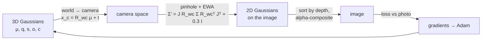
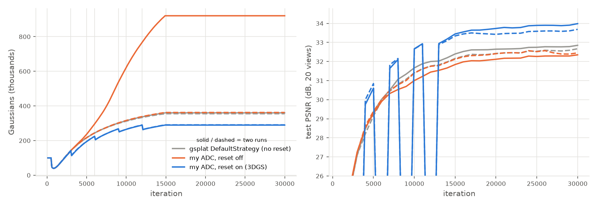

# Gaussian Splatting from scratch on a single T4

The goal of this project is to build **3D Gaussian Splatting** (Kerbl et al., SIGGRAPH 2023)
step by step, mostly from scratch. It finishes with the best reconstruction a single
NVIDIA T4 can produce of a real object: a golden pothos in a terracotta pot. Every piece is
written, tested and explained before the next one is added.

So far the full pipeline works on the standard NeRF-Synthetic **lego** benchmark: **34.15 dB
PSNR at 800×800 in 15 minutes**, with my own densification code. The plant capture
(Stages 6–9) comes next.


*Left to right: ground truth · Stage 4 (my pure-PyTorch renderer, 400², fixed set of Gaussians) ·
Stage 5 with gsplat's CUDA rasterizer but still a fixed set · Stage 5 with my adaptive density
control (34.15 dB). The bottom rows zoom on the orange box.*

---

## 1. The idea in one page

A scene is represented by **N 3D Gaussians** ("blobs"). Each has

| parameter | meaning | stored as |
|---|---|---|
| mean μ ∈ ℝ³ | position | raw |
| rotation q | orientation (unit quaternion) | raw 4-vector, normalized on use |
| scales s ∈ ℝ³₊ | size along its 3 axes | log s, so s = exp(·) > 0 |
| opacity o ∈ (0,1) | how much light it blocks | logit, o = sigmoid(·) |
| color c ∈ [0,1]³ | RGB | logit, c = sigmoid(·) |

Its shape is the covariance **Σ = R S Sᵀ Rᵀ** (R from q, S = diag(s)). Optimizing (q, s)
instead of Σ keeps Σ a valid (positive semi-definite) covariance after any gradient step.

**Rendering an image** takes three steps, all differentiable:



1. **Projection.** Each mean is moved into the camera frame and projected with the pinhole
   model, u = fₓ x/z + cₓ. The perspective map is not linear, so EWA splatting (Zwicker 2002)
   linearizes it around the mean: with J its 2×3 Jacobian, a 3D Gaussian becomes a 2D Gaussian
   with covariance **Σ′ = J R Σ Rᵀ Jᵀ + 0.3 I** (the 0.3 px² keeps every splat at least about
   a pixel wide).
2. **Compositing.** At each pixel, the Gaussians are visited front to back. Each blocks a
   fraction αₖ = oₖ·exp(−½ dᵀΣ′⁻¹d) of the remaining light:

   **C = Σₖ cₖ αₖ Tₖ + T_final · background**, with transmittance **Tₖ = ∏_{j<k} (1 − αⱼ)**.

   Once T < 10⁻⁴ the pixel is opaque and the rest is skipped (early termination).
3. **Training.** Render a training view, compare it to the photo with
   **L = 0.8·L1 + 0.2·(1 − SSIM)**, backpropagate to all Gaussian parameters, and take an Adam
   step. Repeat for ~30k iterations, a random view each time.

A fixed set of Gaussians can move and reshape but cannot increase in number. **Adaptive
density control** adds Gaussians where the image is still wrong and removes useless ones
(Section 3, Stage 5).

---

## 2. Results at a glance

| stage | what | key result |
|---|---|---|
| 0 | environment on the T4 | GPU is power-capped at 70 W: FP32 4.3 TFLOPS sustained, 232 GB/s |
| 1 | fit a photo with 2D Gaussians | **38.6 dB** with 20k Gaussians on 512² (target > 30) |
| 2 | 3D renderer in pure PyTorch | 15 tests incl. `gradcheck`; EWA matches autograd to 10⁻¹⁰ |
| 3 | recover 200 known Gaussians | exact from a near start; 81 % from a random start, **97.5 %** with 2× Gaussians |
| 4 | lego with my renderer | **27.9 dB** at 400²; breaks at ~80 M pixel–Gaussian pairs (memory) |
| 5 | gsplat CUDA rasterizer + my densification | **34.15 dB** at 800² (target ≳ 32), 15 min, 0.8 GB |

All numbers are on held-out views and come from runs logged under `outputs/` (config, git
commit, metrics). The full tables are in [`docs/DETAILED_NOTES.md`](docs/DETAILED_NOTES.md).

---

## 3. Stage by stage

### Stage 0 — Environment

A CloudVeneto VM with a Tesla T4 (16 GB, compute capability 7.5), driver 580, CUDA 12.6,
PyTorch 2.14, gsplat 1.5.3 compiled for sm_75, and COLMAP.

* **Measured, not assumed:** the T4 is held at its 70 W limit. Under heavy arithmetic the
  clock drops from 1590 to ~800 MHz, so FP32 is 4.3 TFLOPS, about half the spec. Memory-bound
  work runs at full clock.
* **Consequence:** splatting is limited by memory traffic and kernel launches, not FLOPs.
  "Using the whole GPU" means keeping it busy (data on the GPU, no CPU stalls, fused
  kernels), not raising clocks.

### Stage 1 — An image as a sum of 2D Gaussians

Before going 3D, fit a single 512×512 image with N 2D Gaussians, rendered by my own sparse
renderer. It only evaluates the (Gaussian, pixel) pairs inside each 3σ ellipse; a dense
N × pixels tensor would have 5·10⁹ entries.

| N | additive blending | alpha compositing |
|---|---|---|
| 1k | 24.8 dB | 25.3 dB |
| 5k | 31.0 dB | 31.9 dB |
| 20k | 37.8 dB | **38.6 dB** |


* PSNR grows linearly with log N: +6.6 dB for every 4× more Gaussians.
* In 2D, ordering barely matters, because nothing hides anything else.
* The transmittance T is a running product per pixel, computed as a **cumulative sum of
  log(1−α)**. That sum must be done in float64: in float32 it loses about 0.1 in log T to
  cancellation.

### Stage 2 — The 3D renderer, in pure PyTorch

Projection, EWA covariance, culling of Gaussians behind the camera, depth sorting and
compositing, written with plain tensor operations. Every piece is checked against something
independent:

* the EWA Jacobian against `torch.autograd`'s Jacobian of the real projection (agrees to 10⁻¹⁰);
* the projected covariance against a Monte Carlo estimate from 400k projected samples (2 %);
* the whole renderer against a brute-force dense version, and `gradcheck` in float64 through
  quaternions, scales, opacities and colors.


Hand-placed Gaussians render where the geometry predicts. For example, the thin yellow disk
is face-on at 0°, oblique at 180° and almost edge-on at 120°/240°, as computed from its
normal.

### Stage 3 — An inverse problem with a known answer

Render 50 views of **200 known Gaussians**, then try to recover them from scratch. The answer
is known, so failures can be explained, not just measured.

| start | test PSNR | Gaussians recovered |
|---|---|---|
| truth + noise | 61.4 dB | 100 % |
| random, N = 200 (3 seeds) | 34.5 dB | 81.5 % |
| random, **N = 400** | 60.7 dB | **97.5 %** |

What we learned:

* **Only Σ is identifiable, not (q, s).** q and −q are the same rotation, and swapping two
  axes together with their scales gives the same ellipsoid. Raw quaternions of correctly
  recovered Gaussians differ by ~180°, yet their principal axes agree within 0.4°.
* **Failures are local minima on barely visible Gaussians**: 36 % failure among the least
  visible quarter vs 11 % for the rest. One wrong splat sits between two targets as a
  compromise, and gradient descent can't split it in two.
* **Spare capacity fixes it.** With twice as many Gaussians, almost everything is found and
  the extras fade out. This is the motivation for densification.


### Stage 4 — Real benchmark data, and where pure PyTorch breaks

The NeRF-Synthetic lego: 100 training views and 200 test views. The Blender poses (OpenGL
axes) are converted to the OpenCV convention used everywhere else.

* **Result:** 27.88 dB at 400×400 with 100k Gaussians, 33 minutes. The lego is clearly
  recognizable but soft.
* **Cost model.** Time and memory are proportional to the number P of (Gaussian, pixel) pairs
  evaluated: **≈ 20 ms and 177 bytes per million pairs**. The 16 GB card therefore holds at
  most **~80 M pairs**. At 800×800 with 1 M Gaussians that is 1.2 s per iteration, i.e.
  **10 hours per training run**.
* **Why:** my renderer computes every pair, even those behind opaque surfaces. Early
  termination zeroes them but doesn't skip the work.


### Stage 5 — A real GPU rasterizer, then densification

**gsplat**, a tiled CUDA rasterizer, drops in behind the same interface as my renderer. It
groups Gaussians per 16×16 tile and actually stops once a tile is opaque.

* **Agreement:** with the same constants, gsplat and my renderer give the same images to
  ~10⁻⁶ and the same gradients (cosine similarity 1.000000).
* **Speed:** 5–46× faster and 10–50× less memory. The configuration that ran out of memory
  in PyTorch takes 48 ms.

A faster renderer alone wasn't enough: a fixed random set of Gaussians stalled at
**28.95 dB**, with 97 % of the error on the object. The fix is **adaptive density control**,
which I wrote myself in [`src/densify.py`](src/densify.py). Every 100 iterations:

* compute each Gaussian's average **screen-space gradient** of the loss. If it is large, the
  region is still poorly reconstructed;
* **clone** small Gaussians there, and **split** large ones into two smaller children sampled
  from the parent;
* **prune** nearly transparent or oversized Gaussians;
* every 3000 iterations, **reset all opacities** to ≤ 0.01. Gaussians that don't earn their
  opacity back get pruned, which removes floaters.

| densification | final Gaussians | test PSNR |
|---|---|---|
| none (fixed set) | 300k | 28.95 dB |
| gsplat's built-in strategy | ~360k | 32.96 / 32.80 dB |
| **mine, with opacity reset** | ~290k | **34.15 / 33.89 dB** |



Two findings worth keeping:

* **gsplat 1.5.3 never resets opacity.** Its condition
  `step % reset_every == 0 & step > 0` is read by Python as a chained comparison that is
  always False. With the reset off, my code makes *bit-identical* decisions to gsplat's
  (checked in a unit test and inside a real training run). Turning the reset on, as the 3DGS
  paper describes, gives **+1.3 dB with 20 % fewer Gaussians**.
* **Without the reset, growth is unstable:** one of four reset-off runs ran away to 920k
  Gaussians. With the reset, the two runs end within 1 % of each other.

---

## 4. Lessons so far

1. **Test against something independent.** Autograd Jacobians, Monte Carlo, dense reference
   renderers and a lockstep comparison against gsplat caught every real bug, including one
   in gsplat itself.
2. **The parameterization decides what can be learned.** Log-scales and quaternions keep Σ
   valid, but only Σ is identifiable, so compare covariances, not parameters.
3. **Capacity must be placed, not just added.** More random Gaussians create floaters;
   densification puts them where the gradient says the image is wrong.
4. **On a T4, the bottleneck is memory traffic, not arithmetic.** Count the work (pairs,
   tiles) to predict time and memory before running out of either.

## 5. Next

* **Stage 6:** plant photos → COLMAP camera poses → foreground masks → data loader.
  How to take the photos: [`docs/CAPTURE_GUIDE.md`](docs/CAPTURE_GUIDE.md).
* **Stage 7:** plant training, one feature at a time (mask loss, densification, spherical
  harmonics for view-dependent leaf sheen, SfM vs random initialization).
* **Stage 8:** push resolution and Gaussian count to the T4's limits (AbsGS, 3DGS-MCMC,
  anti-aliasing).
* **Stage 9:** evaluation, `.ply` export for SuperSplat, orbit video.

---

## Running it

```bash
bash scripts/setup_env.sh               # conda env "gsplat" on /mnt (once)
conda activate gsplat
pytest                                  # 43 tests: renderers, gradcheck, densification
python -m src.fit2d model.n=20000       # Stage 1
python -m src.train --config configs/stage5_lego_adc.yaml   # lego, 800², my densification (~15 min)
bash scripts/tensorboard.sh             # TensorBoard on :6006
```

Each run writes `outputs/<date>_<name>/` with the merged config, the git commit, metrics,
TensorBoard logs and test renders. `python -m src.train --resume outputs/<run>` continues an
interrupted run.

## Code map

| file | what it does |
|---|---|
| [`src/gaussians.py`](src/gaussians.py) | parameters, activations, quaternion → R, Σ = R S Sᵀ Rᵀ |
| [`src/camera.py`](src/camera.py) | camera conventions (OpenCV), `look_at`, Blender loader |
| [`src/render_torch.py`](src/render_torch.py) | my renderer: projection, EWA, culling |
| [`src/rasterize.py`](src/rasterize.py) | my sparse depth-sorted compositing (shared by 2D and 3D) |
| [`src/render_gsplat.py`](src/render_gsplat.py) | gsplat behind the same interface |
| [`src/densify.py`](src/densify.py) | my adaptive density control |
| [`src/losses.py`](src/losses.py) | L1, SSIM (matches scikit-image to 10⁻¹⁶), PSNR |
| [`src/train.py`](src/train.py) | training loop: per-parameter Adam, checkpoints, resume |
| [`src/splat2d.py`](src/splat2d.py), [`src/fit2d.py`](src/fit2d.py) | Stage 1 (2D) |
| [`src/synthetic.py`](src/synthetic.py), [`src/fit_synthetic.py`](src/fit_synthetic.py) | Stage 3 (inverse problem) |
| [`tests/`](tests/) | pytest suite |
| [`docs/DETAILED_NOTES.md`](docs/DETAILED_NOTES.md) | every table, profile and analysis, stage by stage |
