# Gaussian Splatting of a potted plant, from scratch on a T4

A progressive, mostly from-scratch implementation of 3D Gaussian Splatting
(Kerbl et al., SIGGRAPH 2023), ending with the highest-fidelity reconstruction a single
NVIDIA T4 can produce of a golden pothos in a terracotta pot. Each stage is built, tested
and explained before the next; this README is updated with the results of every stage.

| Stage | Topic | Status |
|---|---|---|
| 0 | Environment and scaffolding | ✅ |
| 1 | 2D Gaussian image fitting | ✅ 38.56 dB @ 20k Gaussians (placeholder image) |
| 2 | 3D forward model in pure PyTorch | ✅ 15 tests incl. gradcheck, EWA vs Monte Carlo |
| 3 | Synthetic inverse problem | ✅ exact recovery from GT+noise; 81.5 % from random init, 97.5 % with 2× Gaussians |
| 4 | Blender lego with my renderer | ✅ 27.88 dB at 400² (no densification); breaks at ~80 M pairs / 10 h per run at 800² |
| 5 | Tiled CUDA rasterizer (gsplat) | ✅ 32.96 dB at 800² with gsplat's reference densification; my own densification next |
| 6 | Plant data pipeline | |
| 7 | Plant training ablations | |
| 8 | Pushing the T4 to maximum detail | |
| 9 | Evaluation and deliverables | |

## Quick start

```bash
bash scripts/setup_env.sh            # Miniforge + conda env "gsplat" on /mnt (once)
conda activate gsplat
pytest                               # renderer unit tests + gradcheck
python -m src.fit2d model.n=20000    # Stage 1: fit an image with 2D Gaussians
bash scripts/tensorboard.sh          # TensorBoard on :6006 (ssh -L 6006:localhost:6006 <vm>)
```

Every run writes `outputs/<date>_<name>/` with the merged `config.yaml`, `meta.json`
(git commit, torch/CUDA, GPU), `metrics.json`, TensorBoard logs and renders.
Configs are YAML in `configs/`, inherit with `_base_:`, and accept `key=value` overrides.

---

## Stage 0: Environment

| | |
|---|---|
| GPU | Tesla T4, 15 GB, sm_75, driver 580.178.04 |
| CPU / RAM | 15 cores Xeon Gold 5218, 88 GiB |
| Disk | 24 GB root (nearly full) + 500 GB ephemeral volume reformatted to ext4 at `/mnt` |
| Software | Python 3.12, torch 2.14.1+cu126, nvcc 12.6 + gcc 13, gsplat 1.5.3 (JIT, sm_75), COLMAP 3.12.6 (CPU) |

**What the T4 can actually deliver** (`scripts/gpu_bench.py`, 15 s sustained per test):

| Workload | Measured | Spec | SM clock under load |
|---|---|---|---|
| FP32 matmul | 4.32 TFLOPS | 8.1 | 870 MHz (power-capped) |
| FP16 tensor-core matmul | 25.2 TFLOPS | 65 | 690–735 MHz (power-capped) |
| Device memory copy | 232 GB/s | 320 | 1590 MHz (full boost) |

The card is pinned at its **70 W limit** (which is also the maximum allowed), and thermals
are fine (< 50 °C). Dense arithmetic drops the clock to about half of boost, while
memory-bound kernels run at full speed. Splatting is bandwidth- and launch-bound, so the
way to "use the whole T4" is to keep it busy (GPU-resident data, no per-iteration host
syncs, fused kernels), not to chase FLOPS.

Setup pitfalls hit and fixed: Ubuntu's `colmap` package is missing its `libposelib`
dependency; conda's `cuda-nvcc` activation script breaks under `set -u`; conda-forge keeps
CUDA headers in `targets/x86_64-linux/include`, so gsplat's JIT build needs `CPATH`.

---

## Stage 1: Fitting an image with 2D Gaussians

Fit a 512×512 crop with N 2D Gaussians, each with a mean μ, rotation θ, log-scales,
an RGB color and a sigmoid opacity. Code: [`src/splat2d.py`](src/splat2d.py) (renderer),
[`src/fit2d.py`](src/fit2d.py) (training), tests in
[`tests/test_splat2d.py`](tests/test_splat2d.py).

> The target is a **placeholder** (the 512×512 `astronaut` test image) until the plant
> photos are captured; `bash scripts/stage1_sweep.sh image.path=<plant crop>` reruns
> everything.

### Model

In pixel coordinates (x right, y down, pixel centers at half-integers):

$$
\Sigma = R(\theta)\,\mathrm{diag}(s_1^2, s_2^2)\,R(\theta)^\top,\qquad
q(p) = (p-\mu)^\top \Sigma^{-1} (p-\mu) = \left(\tfrac{u}{s_1}\right)^2 + \left(\tfrac{v}{s_2}\right)^2,\quad
\begin{pmatrix}u\\v\end{pmatrix} = R^\top (p-\mu)
$$

$G(p) = e^{-q/2}$, truncated to the 3σ ellipse $q < 9$. Working in the Gaussian's own
frame means Σ is never inverted.

- **Additive:** $C(p) = \sum_k o_k G_k(p)\, c_k$
- **Alpha compositing** (front to back in a fixed depth order):
  $\alpha_k = \min(0.99,\ o_k G_k)$, $\;C = \sum_k c_k \alpha_k T_k + T_\text{final}\,\text{bg}$,
  $\;T_k = \prod_{j<k}(1-\alpha_j)$, with 3DGS early termination
  (stop once $T_k(1-\alpha_k) < 10^{-4}$).

**Sparse evaluation.** A dense N × HW tensor would hold 5·10⁹ entries at N = 20k. Instead
the renderer enumerates only (Gaussian, pixel) pairs inside each 3σ ellipse (2–4 M pairs),
sorts them by (pixel, depth), and computes the transmittance as a per-pixel running sum
in log space:

$$\log T_k = \sum_{j<k,\ \text{same pixel}} \log(1-\alpha_j)$$

That is one global `cumsum` minus its value at each pixel's first pair. It must be done in
**float64**: the global sum reaches about −10⁶, and float32 would lose about 0.1 in log T to
cancellation.

**Verification:** the sparse renderer matches a brute-force dense renderer to 1e-10 (both
blending modes, with and without early termination), and `torch.autograd.gradcheck`
passes in float64 for means, rotation, scales, colors and opacity.

### Results (4000 Adam iterations, L2 loss, uniform random init)

| Blending | N | PSNR (dB) | ms / iter | pairs (M) | peak VRAM (GB) |
|---|---|---|---|---|---|
| additive | 1k | 24.81 | 52 | 2.02 | 0.77 |
| additive | 5k | 30.99 | 58 | 2.27 | 0.96 |
| additive | 20k | 37.82 | 61 | 2.33 | 1.03 |
| alpha | 1k | 25.33 | 84 | 2.58 | 1.06 |
| alpha | 5k | 31.87 | 117 | 3.57 | 1.69 |
| alpha | 20k | **38.56** | 129 | 3.97 | 1.95 |

Acceptance (> 30 dB at 20k Gaussians on a 512 px crop): ✅ 38.56 dB.


Alpha compositing renders: full image (top) and a 128×128 zoom on the face (bottom):


Additive renders, for comparison:


### Observations

1. **Additive is within 0.5–0.9 dB of alpha compositing and about 2× faster.** In 2D nothing
   occludes anything, so depth ordering adds little flexibility. It becomes essential in
   3D, where occlusion has to be modelled.
2. **PSNR is linear in log N**: about +6.6 dB per 4× Gaussians, i.e. MSE ∝ N^−1.1.
   At 1k the face is a blur, 5k recovers shapes but not freckles or hair strands, and 20k
   is close to the target.
3. **Alpha blending pays for hidden Gaussians.** Pair counts grow from 2.6 M to 4.0 M with
   N because Gaussians grow as they get stacked. In this pair-based layout early
   termination only zeroes their contribution; it doesn't skip the work. This overdraw is
   what a tiled CUDA rasterizer (Stage 5) avoids.
4. **The first bottleneck was autograd, not the math.** 45 % of GPU time was the
   sort-based backward of `x[gid]` gathers. Sorting the integer pairs before any
   differentiable step and using a single packed `index_select` gave 1.35×. The cost is
   that the backward pass is now non-deterministic at the ~10⁻¹⁶ level.

---

## Stage 2: 3D forward model in pure PyTorch

Code: [`src/gaussians.py`](src/gaussians.py) (quaternion → rotation, covariance),
[`src/camera.py`](src/camera.py) (conventions, `look_at`, orbits),
[`src/render_torch.py`](src/render_torch.py) (projection, EWA, culling),
[`src/rasterize.py`](src/rasterize.py) (depth-sorted compositing, shared with Stage 1).
Tests: [`tests/test_render_torch.py`](tests/test_render_torch.py).

### Conventions

* Camera frame as in COLMAP/OpenCV/gsplat: **x right, y down, z forward**.
* `viewmat` = world→camera `[[R, t], [0, 1]]` acting on column vectors:
  $x_\text{cam} = R\,x_\text{world} + t$ (row-stacked points: `X @ R.T + t`).
* Pixel coordinates: origin at the top-left *corner*; pixel (i, j) is sampled at (j + ½, i + ½).
* Quaternions are `(w, x, y, z)`, stored unnormalized and normalized on use.

### Model

$$\Sigma = R\,S\,S^\top R^\top,\qquad R = R(q/\lVert q\rVert),\quad S = \mathrm{diag}(e^{\ell_1}, e^{\ell_2}, e^{\ell_3})$$

so Σ stays symmetric positive semi-definite under any gradient step. A Gaussian at
camera-space position $t = (t_x, t_y, t_z)$ projects to $u = f_x t_x/t_z + c_x$,
$v = f_y t_y/t_z + c_y$. EWA linearizes the perspective map at $t$:

$$\Sigma' = J\,R_{wc}\,\Sigma\,R_{wc}^\top J^\top + 0.3\,I,\qquad
J = \begin{pmatrix} f_x/t_z & 0 & -f_x t_x/t_z^2\\ 0 & f_y/t_z & -f_y t_y/t_z^2\end{pmatrix}$$

$t_x/t_z$ and $t_y/t_z$ are clamped to 1.3× the field of view before building $J$ (as in
3DGS/gsplat). The 0.3 px² dilation keeps every splat at least about one pixel wide. An
optional antialiased mode multiplies opacity by
$\sqrt{\det(\Sigma'-0.3I)/\det\Sigma'}$ (Mip-Splatting), which conserves energy instead.

**Culling:** near < $t_z$ < far, positive-definite Σ′, and the 3σ box must overlap the
image. Culled Gaussians get placeholder depths, so no `0·inf = NaN` can leak into the
backward pass. **Compositing:** per pixel front to back by camera depth of the
Gaussian center, $\alpha=\min(0.99, o\,e^{-q/2})$, skip $\alpha<1/255$, early
termination at $T<10^{-4}$.

### Verification (15 tests, all passing)

| Test | What it checks |
|---|---|
| quaternion → R | identity, +90° about z, invariance to scale and sign, orthonormal with det = +1 |
| covariance | eigenvalues of Σ equal the squared scales |
| `look_at` | OpenCV axes, proper rotation; world +y up appears at the top of the image |
| pinhole | on-axis point → principal point; off-axis values by hand |
| **EWA vs autograd** | $J R_{wc}$ equals `torch.autograd.functional.jacobian` of the real world→pixel map (1e-10) |
| **EWA vs Monte Carlo** | covariance of 400k projected samples matches Σ′ (2 %) |
| culling | behind camera, inside near plane, far outside frustum → radius 0; empty image = bg |
| compositing | center pixel = $o\,c + (1-o)\,\text{bg}$; the front Gaussian wins whatever the index order |
| sparse = dense | sparse renderer vs brute-force O(N·HW) compositing (1e-10), with and without the 1/255 skip |
| multi-view | a small Gaussian's brightest pixel contains $K[R\,|\,t]P$ (computed by hand) from 4 viewpoints |
| antialiased | opacity compensation ≈ 1 for large splats, ≪ 1 for sub-pixel ones |
| **gradcheck** | float64 gradients w.r.t. means, quaternions, scales, opacities, colors |

### Visual check: hand-placed scene from several views

29 hand-placed Gaussians: coordinate axes (+x red, +y green, +z blue), a thin disk tilted
45° about x, and a ring of anisotropic Gaussians
([`scripts/stage2_scene.py`](scripts/stage2_scene.py)).

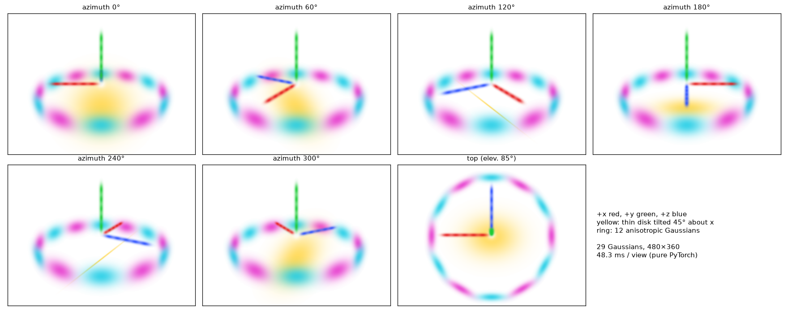

The geometry matches what you'd predict by hand:

* At azimuth 0° the camera sits on −z looking toward +z, so **+x points left** (right-handed
  world) and +z points away, foreshortened to a dot. At 180° +x points right and +z comes
  toward the camera.
* The disk's normal (0, −0.71, 0.71) predicts face-on at 0° (n·d = −0.9), oblique at
  180° (0.42) and **almost edge-on at 120°/240°** (±0.09), which is what the renders show.
* Near ring segments are larger and cover the disk and the far segments (depth sorting).

Projected 3σ footprints from the EWA covariance, drawn over the render:

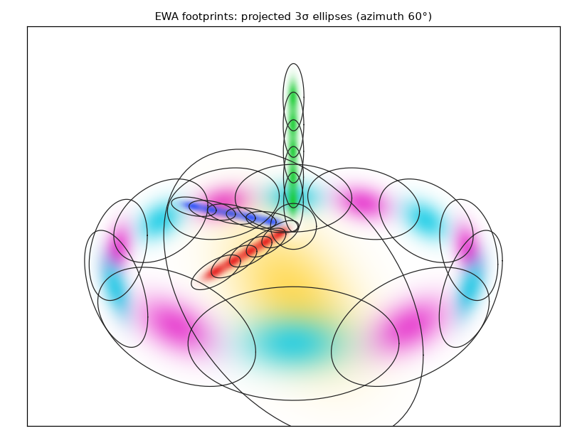

Turntable (48 views):

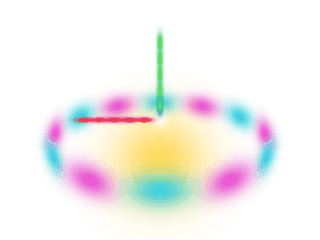

### Observations

1. **Every step can be checked against something independent:** the Jacobian against
   autograd, the linearization against Monte Carlo, and the whole pipeline against
   `gradcheck`. All 15 tests passed on the first run after one handedness bug in my own
   *test* (I had expected +x on the right).
2. **The NaN trap:** a Gaussian behind the camera has $t_z \le 0$, and masking its output
   is not enough, because `where` passes a zero gradient into an `inf`, which gives `NaN`.
   Replacing its depth with a safe placeholder before the projection fixes it.
3. **Pure PyTorch costs about 48 ms for 29 Gaussians at 480×360.** It is dominated by the
   large splats (the disk covers most of the frame) and kernel-launch overhead. Stage 4
   will profile where this breaks down at scale.

---

## Stage 3: Synthetic inverse problem

Render 60 views of 200 known Gaussians, then recover them from scratch with the Stage 2
renderer. Optimization and rendering use the same model, so the problem is exactly
solvable; any residual error is optimization (local minima) or identifiability, never
model mismatch. Code: [`src/synthetic.py`](src/synthetic.py) (scene, metrics),
[`src/fit_synthetic.py`](src/fit_synthetic.py) (training),
[`scripts/plot_stage3.py`](scripts/plot_stage3.py) (analysis).

**Setup:**
* 200 Gaussians in $[-1,1]^3$ with log-uniform anisotropic scales 0.04–0.15, uniformly
  random rotations, opacity 0.6–0.95 and random colors.
* 60 cameras on a Fibonacci sphere at radius 4 (every 6th held out → 50 train / 10 test),
  160×160, white background.
* Adam on L1 with 4 views per step for 6000 steps; exponential decay on the position
  learning rate only.

**Experiments:**
* **A** – ground truth + noise: is the true solution a stable minimum?
* **B** – random init, N = 200 (the task), 3 seeds.
* **C** – random init, N = 400 (twice as many Gaussians as needed).
* **D** – B + relocation of dead Gaussians (a test of the failure diagnosis, below), 3 seeds.

### What can be identified at all

Recovered Gaussians are matched to the ground truth with the Hungarian algorithm (they
can come out in any order). Then **covariances are compared, not (q, s)**: q and −q are
the same rotation, and swapping two axes of R together with their scales gives the same
Σ = R S² Rᵀ. Rotation is only meaningful as the direction of the principal axes, and
only for anisotropic Gaussians. A test checks that a perfect recovery after reordering,
sign flips and axis swaps scores zero error, while a naive quaternion comparison calls it
wrong by > 10°.

A ground-truth Gaussian counts as **recovered** if: position error < 0.03 (≈ 1/10 of the
mean spacing), ‖ΔΣ‖_F/‖Σ‖_F < 0.25, color RMS error < 0.1, and |Δo| < 0.1.

### Results

| group | runs | held-out PSNR (dB) | recovered |
|---|---|---|---|
| A: GT + noise | 1 | 61.38 | 100.0 % |
| B: random, N = 200 | 3 | 34.45 ± 0.71 | 81.5 ± 1.1 % |
| C: random, N = 400 | 1 | **60.68** | **97.5 %** |
| D: random, N = 200 + relocation | 3 | 35.30 ± 0.38 | 86.8 ± 0.2 % |

<details><summary>Per-run table</summary>

| run | seed | N | test PSNR (dB) | recovered | median pos err | median Σ rel err | median axis err (anisotropy > 1.5) | median naive quat err | ms/iter |
|---|---|---|---|---|---|---|---|---|---|
| A | 0 | 200 | 61.38 | 100.0 % | 0.0001 | 0.007 | 0.3° | 0.5° | 44 |
| B | 0 | 200 | 35.18 | 83.0 % | 0.0004 | 0.015 | 0.4° | 180.3° | 45 |
| B | 1 | 200 | 34.67 | 80.5 % | 0.0005 | 0.016 | 0.5° | 180.2° | 51 |
| B | 2 | 200 | 33.49 | 81.0 % | 0.0005 | 0.018 | 0.6° | 180.0° | 47 |
| C | 0 | 400 | 60.68 | 97.5 % | 0.0002 | 0.007 | 0.2° | 180.1° | 50 |
| D | 0 | 200 | 35.17 | 87.0 % | 0.0004 | 0.014 | 0.4° | 180.1° | 45 |
| D | 1 | 200 | 35.82 | 86.5 % | 0.0004 | 0.014 | 0.4° | 180.2° | 45 |
| D | 2 | 200 | 34.91 | 87.0 % | 0.0003 | 0.014 | 0.5° | 179.9° | 45 |
</details>

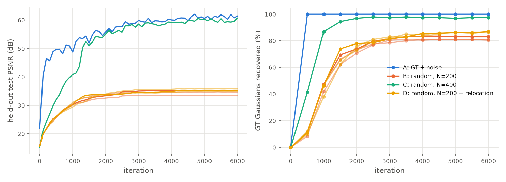

Held-out test views (ground truth, then A–D):

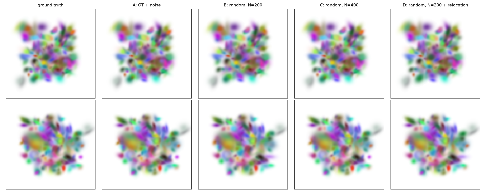

Optimization from a random start (run B, held-out view; left GT, right current estimate,
one frame per 50 iterations):

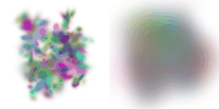

### Analysis

**1. The true solution is a stable minimum (A).** Starting from the ground truth with
noise (position σ = 0.05, i.e. 1/7 of the spacing), all 200 Gaussians return: position
error 10⁻⁴, Σ error 0.7 %, 61 dB. The gradients from Stage 2 and the parameterization
do what they should on the full problem.

**2. Rotation is identifiable only through Σ, and only for anisotropic Gaussians.** On
the *recovered* Gaussians in B, the naive quaternion angle has a median of 180°, as if the
rotations were random. Yet the principal-axis error is 0.4°: the optimizer found
sign-flipped or axis-permuted (q, s) that describe the same ellipsoid. The axis error only
becomes large (10–80°) as anisotropy → 1, where the principal axis isn't defined (right
panel below).

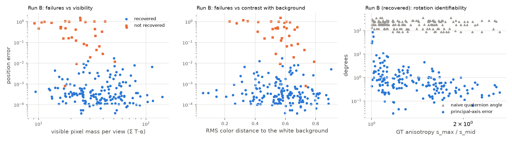

**3. Failures from a random start are local minima, concentrated on barely visible
Gaussians.** About 18 % of the ground-truth Gaussians are not recovered, consistently
across seeds. The failure rate is **36 % in the least-visible quarter vs 11 % for the
rest** (left panel). Visibility is measured exactly: rendering with `colors = I₂₀₀`
gives each Gaussian's compositing weight $T_k\alpha_k$ per pixel in a single pass. The
renders barely show the failures (B looks nearly like the ground truth at 35 dB),
because the unrecovered Gaussians are the ones that contribute little to the images.
Too few Gaussians had colors near the white background (4) to test the color/background
ambiguity.

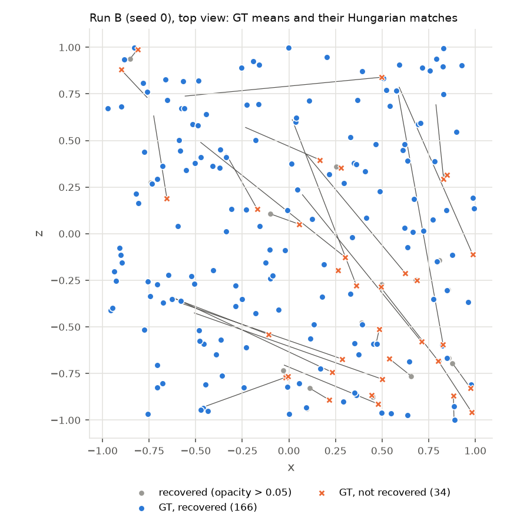

**4. Diagnosis, tested twice: one hypothesis partly confirmed, one falsified.**
* *Dead Gaussians.* In B, 19 recovered Gaussians end transparent (opacity < 0.05) while
  25 ground-truth Gaussians have no recovered Gaussian within 0.1. The gradient of a
  splat's contribution scales with its opacity, so a Gaussian that fades early can't
  travel. **Test (D):** every 500 steps, move dead Gaussians onto live ones, sampled in
  proportion to opacity (3DGS-MCMC-style, splitting opacity as $o' = 1-(1-o)^{1/(k+1)}$
  so the stack keeps the same α, and resetting Adam's moments). Recovery rises from
  81.5 % to 86.8 % on all 3 seeds, but PSNR only by +0.85 dB, so this is only part of
  the story.
* *Compromise Gaussians.* 33 of 34 unrecovered ground-truth Gaussians in B lie inside the
  3σ ellipsoid of a live recovered Gaussian of normal size (only 4 of those are
  oversized). One splat sits between two targets and serves both. I expected these to
  have large per-view gradients that cancel in the sum, the signal 3DGS uses to decide
  where to densify. **That is false at convergence:** their mean per-view screen-space
  gradient is 0.8× that of the other Gaussians, and none is in the top 10 %. Their net
  gradient is 3× smaller: they sit at a genuine stationary point.

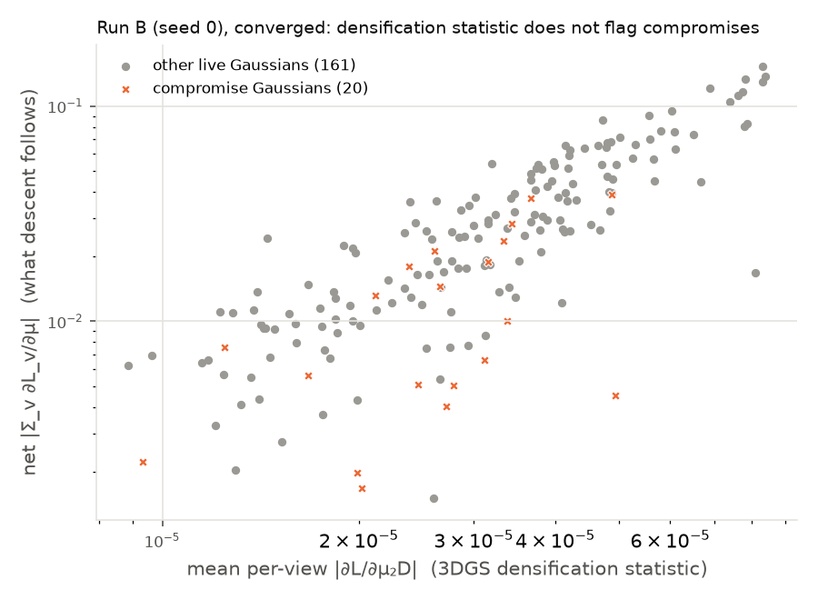

**5. Spare capacity is what works (C).** With 400 Gaussians for 200 targets, 97.5 % are
recovered and held-out PSNR reaches 60.7 dB, close to A. About half of the 400 end up
transparent (207 live): the extra Gaussians let the optimizer explore and then switch off
the losers instead of committing to compromises. Consequences for the real pipeline:
* Use more Gaussians than strictly needed, which is what densification (Stage 7C) and
  dense SfM initialization provide.
* Grow them *during* training, when the errors are still large, rather than trying to
  repair a converged state.
* Prune transparent ones.

Whether the densification statistic flags compromises *during* training (rather than at
convergence) is an open question carried into Stage 7.

---

## Stage 4: Blender lego with my renderer

Train the Stage 2 pure-PyTorch renderer on NeRF-Synthetic `lego` (from a Hugging Face
mirror, `lego` only, 173 MB). Code: [`src/camera.py`](src/camera.py) (`load_blender`),
[`src/losses.py`](src/losses.py), [`src/train.py`](src/train.py),
[`configs/stage4_lego_torch.yaml`](configs/stage4_lego_torch.yaml),
[`scripts/profile_torch_renderer.py`](scripts/profile_torch_renderer.py).

### Data and conventions

`transforms_*.json` stores camera-to-world matrices in Blender/OpenGL axes (x right, y up,
z backward). Converting to our OpenCV axes means negating the camera's y and z axes:
$\text{viewmat} = (\text{c2w}_\text{GL}\,\mathrm{diag}(1,-1,-1,1))^{-1}$. Focal length is
$f = W / (2\tan(\text{fov}_x/2))$. RGBA images are composited onto white at full resolution
and area-downsampled (both steps are linear, so the order is exact). Tests check that every
camera is a proper rotation at r ≈ 4.03 aimed at the origin, and that world-up (Blender +z)
appears as image-up.

### Loss and optimization

$\mathcal{L} = (1-\lambda)\,\lVert I - \hat I\rVert_1 + \lambda\,(1 - \mathrm{SSIM}(I, \hat I))$, with $\lambda = 0.2$
(the 3DGS form). SSIM uses an 11×11 Gaussian window with σ = 1.5. It matches
**scikit-image to 10⁻¹⁶**, while torchmetrics differs by about 3·10⁻⁴ at the borders.

Adam with one learning rate per parameter group, as in 3DGS. Position: 6.4·10⁻⁴ ≈ 1.6·10⁻⁴ ×
scene extent, decayed exponentially to 1/100. Quaternions 10⁻³, log-scales 5·10⁻³,
opacity logits 0.05, color logits 5·10⁻³. One random view per iteration (each view once per
epoch), 30k iterations. There is no densification in this stage (that is Stage 7C), so
following Stage 3 the model starts over-parameterized: **100k Gaussians uniform in
[−1.3, 1.3]³**, opacity 0.1. Training images stay on the GPU as uint8. Checkpoints are
written atomically every 1000 iterations, and `--resume` continues an interrupted run.

### Result: 400×400, 30k iterations

| test views | PSNR | SSIM | train time | ms / iter | peak VRAM | Gaussians with o > 1/255 |
|---|---|---|---|---|---|---|
| all 200 | **27.88 dB** | **0.933** | 33 min | 65 | 1.68 GB | 39.5k of 100k |

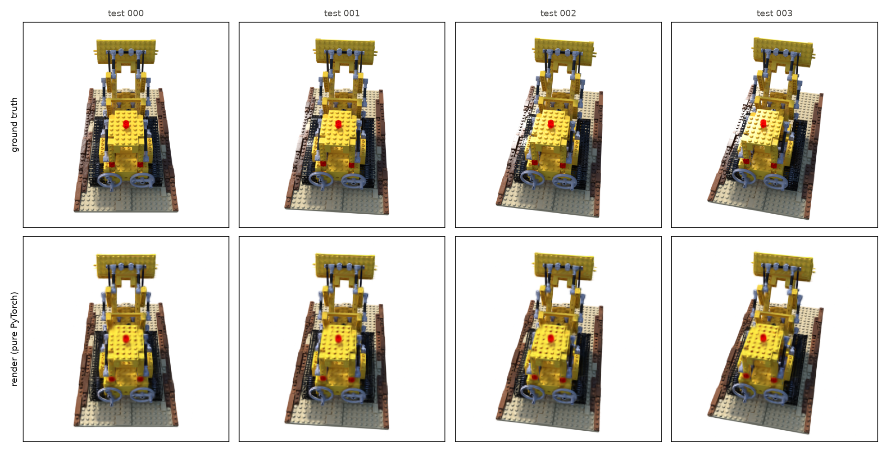

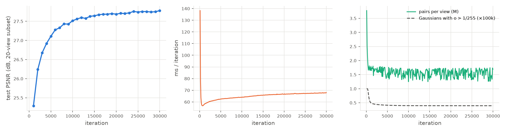

The lego is clearly recognizable. Fine structure (tread links, shading in crevices) is
softened: with a fixed set of 100k Gaussians and no densification, 60 % of them go
transparent in empty space and there is no mechanism to add more where detail is missing.
(For scale: 3DGS with densification reports about 35 dB on lego at 800².)

### Where the pure-PyTorch renderer breaks

The renderer evaluates every (Gaussian, pixel) pair inside each splat's support,
including pairs behind already opaque surfaces. Early termination zeroes their contribution
but doesn't skip the work. Cost is therefore set by the number of pairs P, measured over
44 configurations (random-init and trained states, 200²–800², 10k–3M Gaussians):

$$t \approx 19.9\ \text{ms}\cdot P_{[\mathrm{M}]} + 71\ \text{ms},\qquad
\text{memory} \approx 177\ \text{B}\cdot P + 0.15\ \text{GB}\ \Rightarrow\ P_\text{max} \approx 81\ \text{M pairs on the T4.}$$

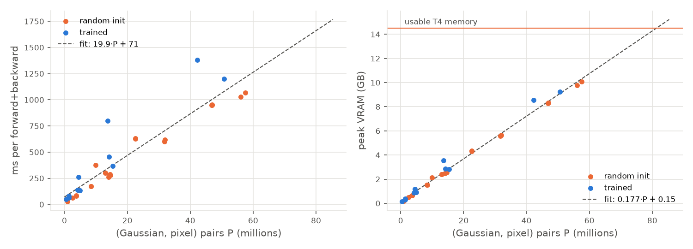

For a given scene, $P \approx \sum_k \text{(footprint area)}_k \propto N\,(s\cdot\text{res})^2$.
With 3DGS-style initialization (isotropic scale = mean spacing $\propto N^{-1/3}$), that is
$P \propto N^{1/3}\,\text{res}^2$: halving the initial scale is exactly like halving the resolution.

Trained lego Gaussians, resampled to N (fwd+bwd of one view):

| resolution | 100k | 300k | 1M | 3M |
|---|---|---|---|---|
| 200² | 48 ms · 0.1 GB | 79 ms · 0.4 GB | 262 ms · 1.2 GB | 800 ms · 3.5 GB |
| 400² | 65 ms · 0.3 GB | 137 ms · 0.9 GB | 455 ms · 2.9 GB | 1382 ms · 8.5 GB |
| 800² | 133 ms · 0.9 GB | 368 ms · 2.8 GB | 1198 ms · 9.3 GB | **OOM** |

**Breaking point.**
* *Memory:* about 80 M pairs. For trained lego Gaussians that is 800² × ~1.5 M Gaussians.
  For a 3DGS-style random init (scale = spacing) it already hits at 400² × 100k, and at
  800² × 10k with half that scale.
* *Time breaks first in practice:* 800² × 1 M Gaussians is 1.2 s per iteration, i.e.
  **10 hours for 30k iterations**. Even 800² × 300k (about what 3DGS ends with on lego) is
  3 hours, before any densification overhead.
* Full-resolution lego (800²) with a realistic Gaussian count is out of reach in pure
  PyTorch on a T4. That is the motivation for Stage 5.

<details><summary>Random-init profiles (init scale as a multiple of mean spacing)</summary>

| resolution | N | scale ×1 | scale ×0.5 | scale ×0.25 |
|---|---|---|---|---|
| 200² | 10k | 263 ms · 2.5 GB | 82 ms · 0.7 GB | 27 ms · 0.2 GB |
| 200² | 100k | 602 ms · 5.6 GB | 173 ms · 1.5 GB | 65 ms · 0.5 GB |
| 200² | 1M | OOM | 633 ms · 4.3 GB | 377 ms · 2.1 GB |
| 400² | 10k | 1029 ms · 9.8 GB | 278 ms · 2.6 GB | 84 ms · 0.7 GB |
| 400² | 100k | OOM | 605 ms · 5.6 GB | 175 ms · 1.5 GB |
| 400² | 1M | OOM | OOM | 626 ms · 4.3 GB |
| 800² | 10k | OOM | 1067 ms · 10.1 GB | 286 ms · 2.6 GB |
| 800² | 300k | OOM | OOM | 951 ms · 8.3 GB |
| 800² | 1M | OOM | OOM | OOM |

Raw data: [`docs/profiles/`](docs/profiles/).
</details>

### Two exact optimizations found while profiling

Both leave the image bit-identical (the sparse = dense tests still pass) and only avoid
work:

1. **Opacity-aware support.** A pair contributes only if $o\,e^{-q/2} \ge 1/255$, i.e.
   $q \le 2\ln(255\,o)$, which is tighter than $q < 9$ whenever $o < 0.35$. That gives 27 % fewer pairs
   at init (o = 0.1). Fully transparent Gaussians are culled outright, so the 60 % that die
   in empty space cost nothing.
2. **Exact ellipse bounding boxes.** Candidates came from a square of half-width
   $3\sqrt{\lambda_\max}$. Trained splats are thin and tilted, so the square was mostly
   empty: at 400² × 1 M trained Gaussians there were **81 M candidates for 14 M real pairs**.
   The ellipse's axis-aligned box has half-widths $\sqrt{q_\max\Sigma'_{xx}}$,
   $\sqrt{q_\max\Sigma'_{yy}}$, where $\Sigma'_{xx} = C/(AC-B^2)$ comes straight from the conic.
   That configuration went from over the cap to 455 ms / 2.9 GB.

---

## Stage 5: Tiled CUDA rasterizer (gsplat), same training loop

Code: [`src/render_gsplat.py`](src/render_gsplat.py) (same interface as `render_torch`),
[`tests/test_render_gsplat.py`](tests/test_render_gsplat.py),
[`scripts/stage5_agreement.py`](scripts/stage5_agreement.py),
[`configs/stage5_lego_gsplat*.yaml`](configs/).

### What gsplat does differently (read from its 1.5.3 CUDA source)

* **Tiles instead of pairs.** Each Gaussian is assigned to the 16×16 tiles its bounding box
  overlaps, (tile, Gaussian) keys are radix-sorted once by depth, and one CUDA block per
  tile composites its list in shared memory and *stops* once every pixel in the tile is
  saturated. Hidden Gaussians are never evaluated, which is exactly the work the
  pair-based PyTorch renderer couldn't skip (Stage 4).
* **Constants.** α clamp 0.999 (the 3DGS paper uses 0.99); support is an opacity-aware box
  of half-width $\min(3.33, \sqrt{2\ln(255\,o)})\sqrt{\Sigma'_{ii}}$ per axis, with no
  ellipse test. `render_torch` gained `alpha_max` and `q_cutoff` parameters to reproduce
  them; its defaults are unchanged, so Stages 1–4 reproduce exactly.
* **Packed mode** (default here) carries only the visible Gaussians through the pipeline.
  Its 1.5.3 shape check rejects a background, so the wrapper composites
  $C + (1-\alpha)\,\text{bg}$ itself (the same $T_\text{final}\cdot\text{bg}$ term).

### Numerical agreement

With gsplat's constants, the two renderers agree **to float32 precision** (300 random
anisotropic Gaussians, 160×120, white background):

| scene | mode | max \|Δ image\| | mean \|Δ image\| | max \|Δ alpha\| |
|---|---|---|---|---|
| seed 0 | classic | 1.0e-06 | 4.4e-08 | 1.2e-06 |
| seed 0 | antialiased | 1.1e-06 | 4.3e-08 | 1.3e-06 |
| seed 1 | classic | 6.9e-07 | 4.1e-08 | 1.4e-06 |
| seed 2 | classic | 9.5e-07 | 5.0e-08 | 7.2e-07 |

| parameter | cosine(∇torch, ∇gsplat) | ‖Δ∇‖ / ‖∇torch‖ |
|---|---|---|
| means | 1.000000 | 8.4e-06 |
| quats | 1.000000 | 5.2e-06 |
| scales | 1.000000 | 7.3e-06 |
| opacities | 1.000000 | 8.9e-06 |
| colors | 1.000000 | 1.6e-05 |

Packed and unpacked modes give identical images. The tests assert max |Δ| < 10⁻⁵ and
gradient cosine > 0.99999.

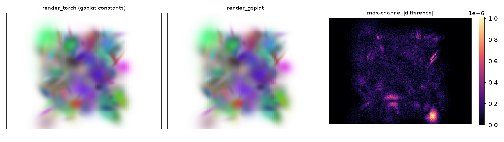

### Speed and memory: same trained-lego states as Stage 4

| resolution | N | PyTorch ms | gsplat ms | speed-up | PyTorch GB | gsplat GB |
|---|---|---|---|---|---|---|
| 200² | 100k | 48 | 5.3 | 9× | 0.14 | 0.01 |
| 200² | 3M | 800 | 36.5 | 22× | 3.54 | 0.32 |
| 400² | 1M | 455 | 15.5 | 29× | 2.87 | 0.12 |
| 400² | 3M | 1382 | 32.0 | 43× | 8.53 | 0.32 |
| 800² | 300k | 368 | 20.0 | 18× | 2.82 | 0.13 |
| 800² | 1M | 1198 | 26.3 | 46× | 9.25 | 0.17 |
| 800² | 3M | **OOM** | 47.8 | — | OOM | 0.33 |

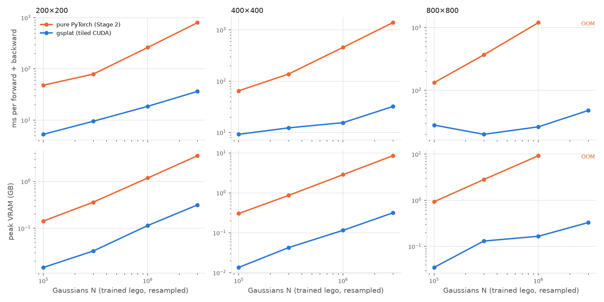

### Lego at 800×800

My training loop, unchanged apart from the backend. The fixed-set runs (no
densification) come first, because the plan schedules densification for Stage 7:

| run | Gaussians | test PSNR (200 views) | SSIM | train / test gap | time | peak VRAM |
|---|---|---|---|---|---|---|
| fixed random set | 100k | 26.83 | 0.910 | — | 9 min | 0.71 GB |
| fixed random set | 300k | 28.95 | 0.941 | — | 11 min | 0.79 GB |
| fixed random set | 1M | 28.06 | 0.945 | 4.5 dB | 17 min | 1.1 GB |
| **+ adaptive density control** (gsplat `DefaultStrategy`) | 100k → 360k | **32.96** | **0.977** | 3.7 dB | 16 min | 0.82 GB |

**Why the fixed set stalls at ~29 dB.** Splitting the squared error by the ground-truth
alpha mask:
* Floaters in empty space account for 20 % of the error with 1M Gaussians, vs 3–4 % with
  100k–300k. That explains 1M < 300k.
* Even at 300k, **97 % of the error is on the object itself**. A fixed, randomly placed set
  can't put capacity where the fine detail is; more Gaussians only add floaters (train
  32.6 dB vs test 28.2 dB at 1M).

**Adaptive density control fixes exactly that.** gsplat's `DefaultStrategy` implements the
3DGS paper's rules:
* Every 100 steps it clones small Gaussians and splits large ones whose accumulated
  screen-space gradient exceeds 2·10⁻⁴, and prunes those with opacity < 0.005 or that are
  too large.
* Every 3000 steps it resets opacity to kill floaters.
* All of this runs between iterations 500 and 15k.

Hooked into my loop (one Adam per tensor, called after the optimizer step as in gsplat's
reference trainer), it first pruned the 100k random Gaussians to ~43k, then grew them to
360k where detail was missing, and passed 32 dB at ~12k iterations. This run is the
reference that my own `densify.py` (next step) has to match.

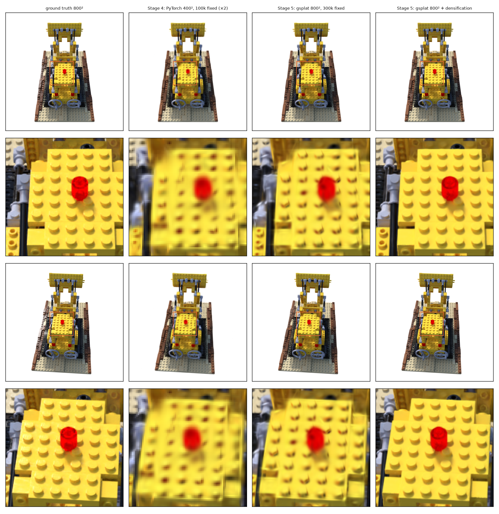

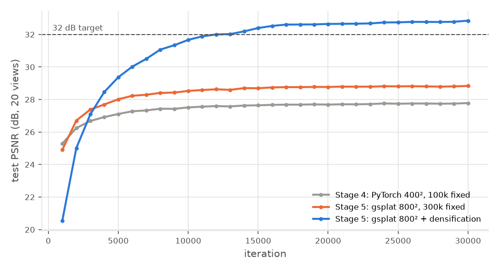

---

## Repository layout

```
configs/      one YAML per experiment
data/      -> /mnt/data      (raw photos, masks, COLMAP, nerf_synthetic; not in git)
outputs/   -> /mnt/outputs   (runs; not in git)
docs/figures/                figures embedded in this README
scripts/      setup_env.sh, check_env.py, gpu_bench.py, gsplat_smoke.py, tensorboard.sh,
              stage1_sweep.sh, plot_stage1.py, stage2_scene.py, stage3_sweep.sh,
              plot_stage3.py, profile_torch_renderer.py, plot_stage4.py,
              stage5_agreement.py, plot_stage5.py
src/          config.py, run.py, splat2d.py, fit2d.py, rasterize.py, gaussians.py,
              camera.py, render_torch.py, render_gsplat.py, synthetic.py, fit_synthetic.py,
              losses.py, train.py,
              and stubs for later stages
tests/        pytest suite
```
