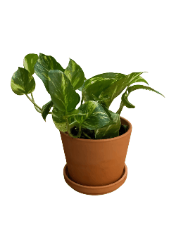
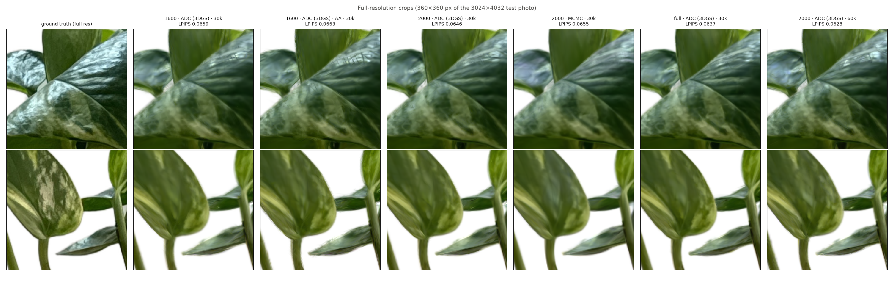

# Gaussian Splatting from scratch on a single T4

**3D Gaussian Splatting** (Kerbl et al., SIGGRAPH 2023) built step by step, mostly from
scratch, then used to reconstruct a real object, a golden pothos in a terracotta pot,
from 216 phone photos on one NVIDIA T4 (16 GB).

<p align="center"><br>
<em>Novel views of the reconstructed plant (390k Gaussians, view-dependent color).
<a href="docs/figures/plant_orbit.mp4">MP4</a></em></p>

## Results

| stage | what | result |
|---|---|---|
| 1 | fit a photo with 2D Gaussians, my renderer | 38.6 dB with 20k Gaussians (512²) |
| 2 | 3D renderer in pure PyTorch | 15 tests incl. `gradcheck`; EWA = autograd Jacobian to 10⁻¹⁰ |
| 3 | recover 200 known Gaussians | 81 % from random init, 97.5 % with 2× Gaussians |
| 4 | NeRF-Synthetic lego, my renderer | 27.9 dB at 400²; limit ~80 M pixel–Gaussian pairs |
| 5 | gsplat CUDA rasterizer + my densification | **lego 34.15 dB at 800²** in 15 min |
| 6 | plant: poses, masks, loader (all GPU) | 216/216 photos posed in 10 min, 1.0 px error |
| 7 | plant ablation (5 runs) | **32.3 dB, LPIPS 0.030** (best: + spherical harmonics) |
| 8 | push the T4: densification × resolution × schedule | **LPIPS 0.0628 at full res** (2000 px, 60k it., 4.8 GB, 2 h) |

All metrics are on held-out views. Every number comes from a logged run (config, git
commit, metrics) and is detailed in **[docs/DETAILED_NOTES.md](docs/DETAILED_NOTES.md)**.

## How it works

A scene is N anisotropic 3D Gaussians: mean μ, rotation q (quaternion), scales s,
opacity o and color c (or spherical-harmonics coefficients). The covariance is built
as **Σ = R(q) diag(s²) R(q)ᵀ**, which stays positive semi-definite under any gradient step.

1. **Project** (EWA splatting): each Gaussian becomes a 2D Gaussian on the image, with
   **Σ′ = J R Σ Rᵀ Jᵀ + 0.3 I**, where J is the Jacobian of the pinhole projection at
   the mean.
2. **Composite** front to back per pixel: **C = Σₖ cₖ αₖ ∏_{j<k}(1 − αⱼ)**, with
   αₖ = oₖ exp(−½ dᵀΣ′⁻¹d). A pixel stops once it is opaque.
3. **Optimize** all parameters with Adam on **0.8·L1 + 0.2·(1 − SSIM)** against the photos.
4. **Densify**: every 100 steps, clone/split Gaussians whose screen-space gradient is
   large (under-reconstructed), prune transparent ones, and periodically reset opacity to
   remove floaters.
5. **View-dependent color**: c(d) = Σ k_lm Y_lm(d) + ½ (real SH up to degree 3)
   reproduces the waxy leaf sheen.

## What each stage taught

* **Renderer (1–2).** A sparse, pair-based PyTorch renderer is exact, matching
  brute-force rendering and `gradcheck`. Transmittance needs a float64 cumulative sum,
  and Gaussians behind the camera need NaN-safe culling.
* **Identifiability (3).** Only Σ can be recovered, not (q, s): q ≡ −q and axis swaps
  give the same Σ. Failures from a random start are local minima; spare capacity fixes
  them, which motivates densification.
* **Cost (4).** Pure PyTorch spends ~20 ms and 177 B per million (pixel, Gaussian) pairs,
  including hidden ones. At 800² with 1 M Gaussians that's 10 h per training run.
* **gsplat (5).** It agrees with my renderer to float32 precision and is 5–46× faster.
  A fixed set of Gaussians stalls at 29 dB; densification reaches 34 dB. **gsplat 1.5.3
  never resets opacity** (a chained-comparison bug); my implementation does, and that
  is worth +1.3 dB with 20 % fewer Gaussians.
* **Data (6).** CPU-only packages (COLMAP, onnxruntime for CUDA 13) were the real
  bottleneck. GPU builds: SfM 89 s → 12 s extraction and 65 → 7 min matching; masks
  23 → 1.5 s/image. iPhone photos still carry ~23 px of lens distortion and must be
  undistorted.
* **Plant (7).** Spherical harmonics gave the largest gain (+1.5 dB on the plant, the
  leaf sheen). The mask loss had no measurable effect against a white background.
  Random initialization comes within 0.1 dB of SfM initialization.
* **Maximum detail (8).** Every run is scored on the full-resolution photos. Training
  resolution and schedule matter far more than the densification method: AbsGS ties the
  3DGS rules, and MCMC wins PSNR but loses LPIPS (smoother texture). 2000 px × 60k
  iterations is the best LPIPS (0.0628) and beats full-resolution training in 62 % of the
  time. Anti-aliasing doesn't blur edges, and every configuration trains in ≤ 5.2 GB:
  time, not memory, is the limit on a T4.

<p align="center"><br>
<em>Full-resolution crops of a held-out photo for the main Stage 8 runs. Higher training
resolution and a longer schedule recover the leaf mottling; MCMC is smoother.</em></p>

## Running it

```bash
bash scripts/setup_env.sh                                    # conda envs on /mnt (once)
conda activate gsplat && pytest                              # 54 tests
python -m src.train --config configs/stage5_lego_adc.yaml    # lego 800², ~15 min
bash scripts/run_colmap.sh data/plant images_2000 incremental  # plant poses (GPU COLMAP)
python -m src.train --config configs/stage8_base.yaml data.res=2000 train.iterations=60000  # best, ~2 h
python -m scripts.view_splats --run outputs/<run>            # interactive viewer on :8080
```

Each run writes `outputs/<date>_<name>/` (config, git commit, metrics, TensorBoard,
renders, checkpoint); `--resume outputs/<run>` continues an interrupted run. Photo
capture instructions: [docs/CAPTURE_GUIDE.md](docs/CAPTURE_GUIDE.md).

| code | |
|---|---|
| [`src/gaussians.py`](src/gaussians.py) · [`src/sh.py`](src/sh.py) | parameters, Σ = R S Sᵀ Rᵀ, SfM/random init, spherical harmonics |
| [`src/render_torch.py`](src/render_torch.py) · [`src/rasterize.py`](src/rasterize.py) | my renderer: projection, EWA, culling, compositing |
| [`src/render_gsplat.py`](src/render_gsplat.py) | gsplat behind the same interface |
| [`src/densify.py`](src/densify.py) | my densification: 3DGS ADC (+AbsGS) and 3DGS-MCMC |
| [`src/camera.py`](src/camera.py) | conventions, Blender and COLMAP loaders |
| [`src/train.py`](src/train.py) · [`src/evaluate.py`](src/evaluate.py) · [`src/losses.py`](src/losses.py) | training loop, evaluation at any resolution, metrics |
| [`scripts/`](scripts/) | data pipeline, sweeps, plots, viewer |
